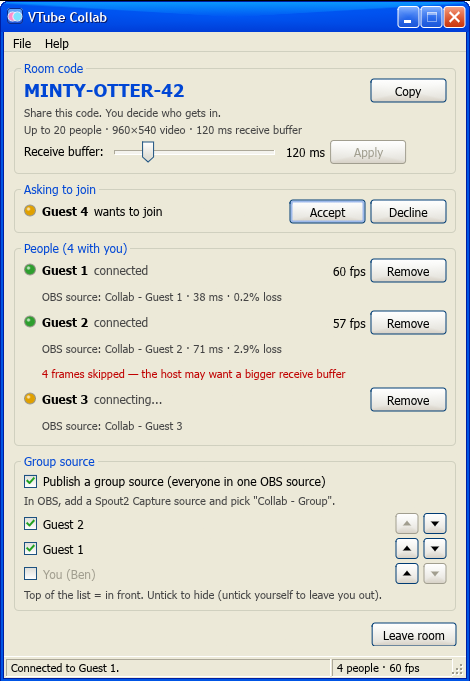
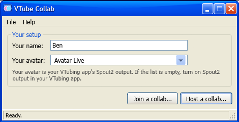
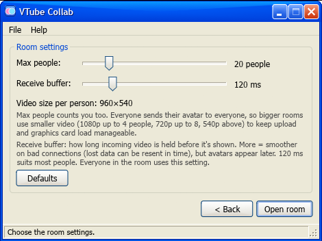
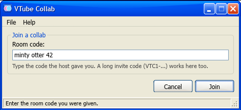

<div align="center">

# VTube Collab

**Collab with other VTubers using any VTubing app.**<br>
Everyone's avatar travels straight between your PCs, transparent background included,
and shows up in OBS as its own source.

[](https://github.com/WindowsBen/VTube-Collab/releases/latest)
[](#requirements)
[](LICENSE)
[](https://streamelements.com/windowsben/tip)



</div>

---

## ✨ Features

- **Works with any VTubing app** that has Spout2 output: VTube Studio, Warudo, VSeeFace, VNyan and more.
- **Real transparency.** Avatars arrive with their background cut out, ready to place in your scene.
- **One short room code** like `MINTY-OTTER-42`. The host decides who gets in.
- **Up to 100 people per room.** Comfortable for small groups on typical home internet.
- **One OBS source per person**, or a single *group* source with everyone stacked in the order you choose.
- **Direct and low-latency.** Video goes from PC to PC, encrypted, encoded on your graphics card.
- **Copes with bad connections.** Lost data is resent, quality adjusts itself, and the host can raise the
  receive buffer for everyone mid-collab.
- **Survives hiccups.** If the room server connection drops, the app reconnects on its own and the video
  keeps running.
- **Free.** No account, no subscription.

## 📋 Requirements

| | |
|---|---|
| **System** | Windows 10 or 11, 64-bit |
| **Graphics** | Any card with H.264 video support (NVIDIA, AMD or Intel) |
| **OBS** | [OBS Studio](https://obsproject.com/) with the [Spout2 plugin](https://github.com/Off-World-Live/obs-spout2-plugin) |
| **VTubing app** | Spout2 output turned on |
| **Internet** | 3–8 Mbit/s upload per person you collab with, about 25 Mbit/s in total for a room of 8 |

## 📥 Install

1. Download the latest **VTubeCollab-x.y.z.zip** from [Releases](https://github.com/WindowsBen/VTube-Collab/releases/latest).
2. Unzip the whole folder somewhere, e.g. *Documents*. Keep the files together.
3. Double-click **`Start VTube Collab.bat`**.

> [!NOTE]
> **"Windows protected your PC"?** Click **More info → Run anyway**. Windows shows this for programs that
> aren't signed with a paid certificate; it doesn't mean anything was found. You only need to do it once per
> version.
>
> **Windows Firewall asks?** Click **Allow**, otherwise partners can't connect to you.

The app tells you when a new version is out.

## 🚀 Quick start

<table>
<tr>
<td width="33%"></td>
<td width="33%"></td>
<td width="33%"></td>
</tr>
<tr>
<td><b>1. Set up.</b> Enter your name and pick your avatar (your VTubing app's Spout2 output).</td>
<td><b>2. Host</b> a collab, choose the room settings and click <b>Open room</b>.</td>
<td><b>Or join:</b> click <b>Join a collab...</b> and type the room code you were given.</td>
</tr>
</table>

3. **Share the room code** with everyone joining and click **Accept** as they ask to join.
4. **In OBS**, add a **Spout2 Capture** source and pick **`Collab - <name>`** for each person.<br>
   Or tick **Publish a group source** and add **`Collab - Group`** once for everyone.

That's it. The host can remove people and change the receive buffer at any time. If the host leaves, the
next person in the room becomes host.

## ⚙️ Room settings

| Setting | What it does |
|---|---|
| **Max people** | Counts you too. Bigger rooms send smaller video to keep upload and graphics card load manageable: **1080p** up to 4 people, **720p** up to 8, **540p** above that. |
| **Receive buffer** | How long incoming video is held before it's shown. More is smoother on bad connections but avatars appear a little later. **120 ms** suits most people; try **200–300 ms** if someone stutters. |

## 🛠️ Troubleshooting

<details>
<summary><b>"Room codes are unavailable right now"</b></summary>
<br>

The room server runs on a free plan with a daily allowance. When it's used up, rooms can't be opened or
joined until **midnight UTC** (the app says how long that is). Collabs that are already running aren't
affected.

Meanwhile you can still collab with **one person** using long codes: the app shows an invite code to send
them, they paste it into **Join a collab...** and send you back their reply code.

If it says the server can't be reached, check your internet and that no firewall or antivirus is blocking
VTube Collab.
</details>

<details>
<summary><b>"Couldn't connect" next to someone</b></summary>
<br>

There's no direct route between your two PCs. Make sure VTube Collab is allowed through Windows Firewall on
**both** PCs. Some work, school or hotel networks and mobile hotspots block direct connections; there's no way
around that yet.
</details>

<details>
<summary><b>Someone's avatar stutters or skips frames</b></summary>
<br>

The People list shows *frames skipped* when lost data couldn't be resent in time. The host can raise the
**Receive buffer** (under the room code) to 200–300 ms. Also check everyone's upload speed at
[speedtest.net](https://www.speedtest.net).
</details>

<details>
<summary><b>My avatar isn't in the list</b></summary>
<br>

Turn on Spout2 output in your VTubing app, then wait a couple of seconds. The list refreshes by itself.
</details>

<details>
<summary><b>Laptop with two graphics cards</b></summary>
<br>

If your avatar can't be opened, set your VTubing app, OBS and VTube Collab to **High performance** in
*Windows Settings → System → Display → Graphics*, then restart them.
</details>

<details>
<summary><b>The video got a bit softer</b></summary>
<br>

When your partners lose part of your video (usually because your upload is busy), VTube Collab lowers your
quality a little and raises it again once things are stable.
</details>

## 🐛 Reporting a problem

[Open an issue](https://github.com/WindowsBen/VTube-Collab/issues/new) and include:

- what happened, who looked bad to whom, and roughly when
- your log file: **File → Open log folder**, then the newest `.log` file
- your upload speed, if it's about stutter

Logs contain technical details and the names of the people in the room, nothing else.

## 🔒 Privacy

- **Video** goes directly between your PCs, encrypted. Nobody else gets it.
- **The room server** (on Cloudflare) passes connection details between the people in a room. It sees your
  name, the room code and your IP address, and keeps nothing about you after you leave. Empty rooms are
  deleted after 10 minutes.
- **People in your room** see your name and IP address, which is needed to connect directly.
- **Update check:** at start, the app asks GitHub whether there's a newer version. Nothing about you is sent.
- **Logs** stay on your PC unless you send them to someone.

---

## 🧑‍💻 Building from source

<details>
<summary><b>Show build instructions</b></summary>
<br>

**You need**

- [Rust](https://rustup.rs/) (stable, 2024 edition)
- [Visual Studio Build Tools](https://visualstudio.microsoft.com/visual-cpp-build-tools/) with the C++ workload
- [GStreamer](https://gstreamer.freedesktop.org/download/) 1.28, **MSVC 64-bit**, including the development
  files, with its `bin` folder on `PATH` and `PKG_CONFIG_PATH` pointing to its `lib\pkgconfig`

**Build and run**

```powershell
cargo build --release -p app       # the app window: target\release\VTubeCollab.exe
cargo build --release -p collab    # command-line tool for testing: target\release\collab.exe
cargo test
```

**Make the release folder and zip** (bundles only the GStreamer parts the app uses)

```powershell
powershell -ExecutionPolicy Bypass -File tools\make-bundle.ps1
```

**Room server** (Cloudflare Workers, free plan)

```powershell
cd handshake
npm install
npx wrangler dev        # local test server on http://127.0.0.1:8787
npx wrangler deploy     # publish
```

Point the app at another server with the `VTC_SERVER` environment variable, e.g.
`$env:VTC_SERVER = "http://127.0.0.1:8787"`. The default address is in `collab/src/rooms.rs`.

**Project layout**

| Folder | What's in it |
|---|---|
| `app/` | The app window (egui) |
| `collab/` | The connection engine: rooms, WebRTC, encoding, decoding. Also the `collab` command-line tool |
| `vtc-core/` | Spout2 capture and output, GPU packing of colour + transparency, the group compositor |
| `handshake/` | The room server (Cloudflare Worker + Durable Objects) |
| `tools/` | Release bundle script |
| `docs/` | The README that ships in the zip, screenshots |

See [DESIGN.md](DESIGN.md) for how it all works and why.
</details>

## 💜 Support

VTube Collab is free and will stay free: no account, no subscription, no paid features.<br>
If it made your collabs better and you'd like to say thanks, you can
**[leave a tip on StreamElements](https://streamelements.com/windowsben/tip)**. It's never expected, and
always appreciated. The app has the same link under **Help → Leave a tip...**.

## 📄 License

VTube Collab is released under the [MIT License](LICENSE).<br>
It uses [GStreamer](https://gstreamer.freedesktop.org/) (LGPL) and other open-source libraries; their licences
ship in the `licenses` folder of every release.

## Disclaimer

VTube Collab is almost entirely written with Claude Code. I as the app creator feel the need to disclose this information for transparency.
Every part of it has been thoroughly reviewed to make sure no security issues are there. However, if you decide to look for some and find them, please report them in [issues](https://github.com/WindowsBen/VTube-Collab/issues/new).